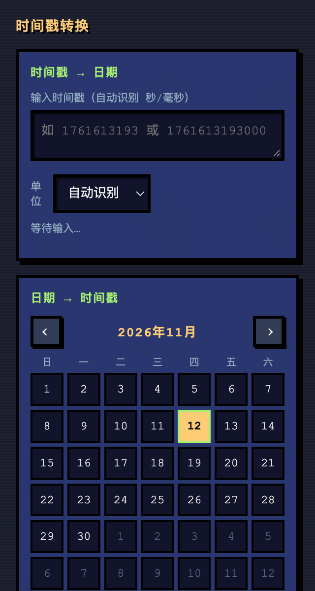
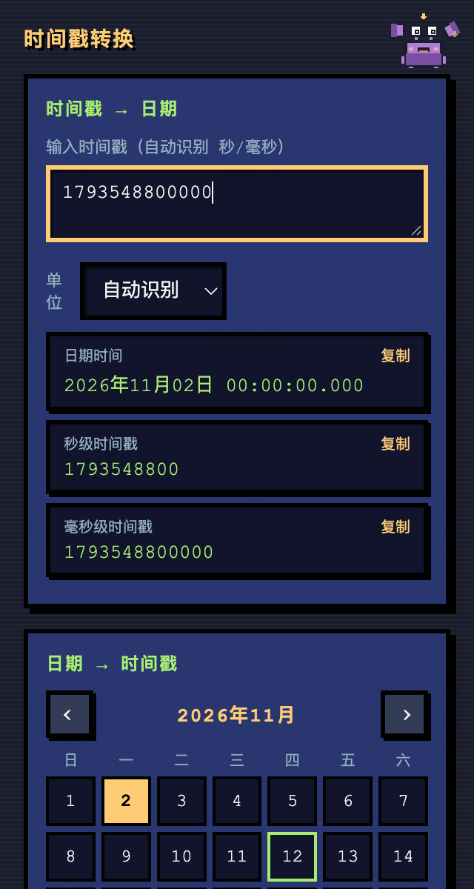
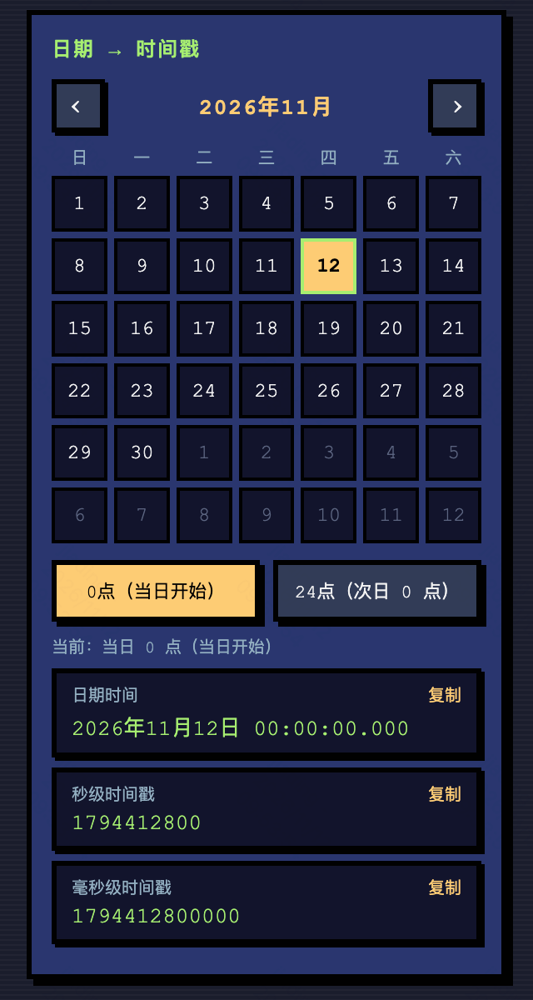
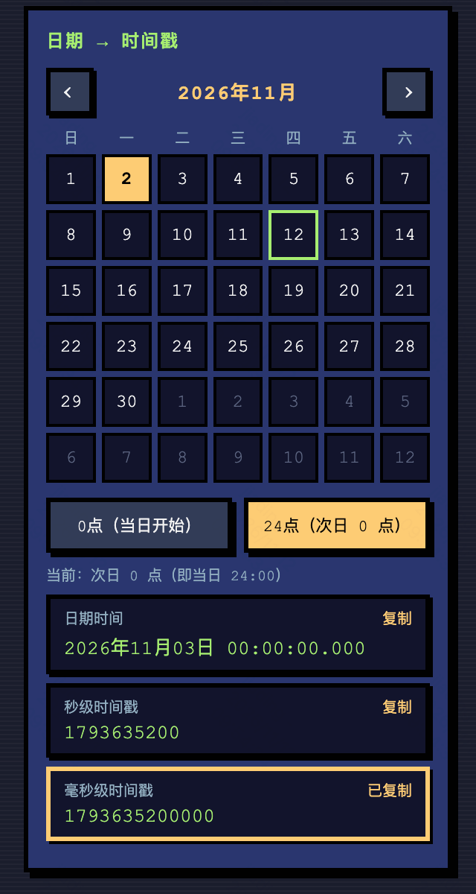
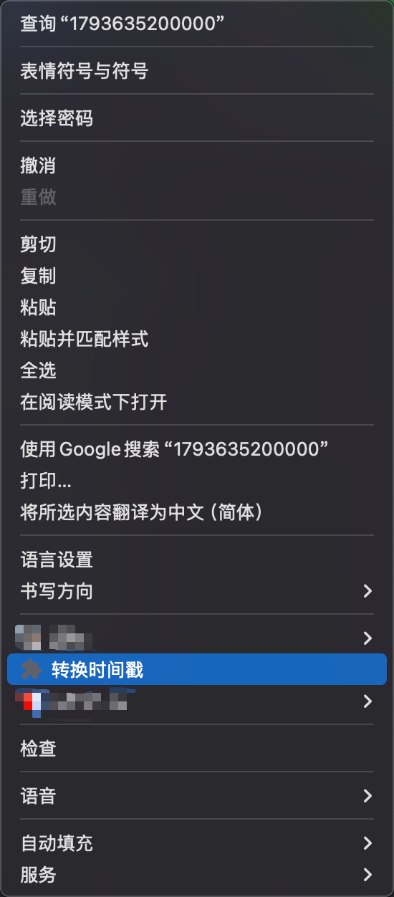
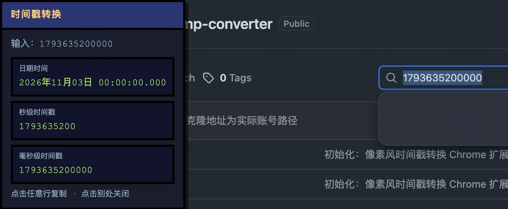

# 时间戳转换 · Timestamp Converter

一个自用的 Chrome 扩展（Manifest V3），在任意网页上把时间戳与日期互转，精确到毫秒。像素风界面，外加一只偶尔溜达的小螃蟹。

纯前端实现，零依赖、零网络请求、零数据收集。

## 功能

- **时间戳 → 日期**：输入秒级（10 位）或毫秒级（13 位）时间戳，自动识别单位，也可手动指定。输出 `YYYY年MM月DD日 HH:mm:ss.SSS`，同时给出秒级与毫秒级结果，点击结果行即可复制。
- **日期 → 时间戳**：自绘像素日历选日期，再选「0 点（当日开始）」或「24 点（次日 0 点）」，按浏览器本地时区换算，输出对应时间戳。
- **右键一键转换**：在网页上选中时间戳或日期文本 → 右键「转换时间戳」→ 页面原位弹出像素风结果浮层，点击复制，点击外部或 10 秒后自动消失。
- **小螃蟹彩蛋**：三只造型不同的像素螃蟹轮流探头，可拖动，带像素化浮现 / 消失效果。

## 效果预览

### 弹窗：双向转换

| 弹窗总览（含像素日历） | 时间戳 → 日期 |
| :---: | :---: |
|  |  |

| 日期 → 时间戳 · 0 点 | 日期 → 时间戳 · 24 点 |
| :---: | :---: |
|  |  |

24 点即次日 0 点，对应「当日结束」边界；点击任意结果行即可复制（右下图显示「已复制」）。

### 右键：选中文本一键转换

在网页上选中时间戳或日期文本后右键，菜单里出现「转换时间戳」：



点击后，像素风结果浮层直接出现在页面上，点结果行复制、点别处或 10 秒后自动关闭：



## 安装

本项目未上架 Chrome 应用店，通过开发者模式加载：

```bash
git clone https://github.com/SmellyTrotter/chrome-timestamp-converter.git
cd chrome-timestamp-converter
```

1. 打开 `chrome://extensions`
2. 打开右上角「开发者模式」
3. 点「加载已解压的扩展程序」，选中**含 `manifest.json` 的这一层目录**
4. 建议把扩展固定到工具栏，方便随时点开弹窗

> 修改代码后，回到 `chrome://extensions` 点卡片上的刷新（↻）按钮重新加载即可生效。

## 使用说明

**单位自动识别**：取整数部分位数，≥ 13 位判断为毫秒，≤ 10 位判断为秒，11~12 位按数值大小（≥ 1e12）判断。也可用「单位」下拉框强制指定为秒或毫秒。

**0 点 / 24 点**：

| 选项 | 实际时刻 | 典型用途 |
| --- | --- | --- |
| 0 点（当日开始） | 所选日期 `00:00:00.000` | 查某天起始边界 |
| 24 点（次日 0 点） | **次日** `00:00:00.000` | 查某天结束边界（左闭右开区间的右端点） |

两者都按浏览器**本地时区**计算，不做 UTC 转换。跨夏令时地区请以实际输出为准。

**日期字符串**：右键转换时，形如 `2026年10月28日 10:19:53`、`2026-10-28 10:19:53` 的文本会优先按日期解析，不会被误当成秒级时间戳。

**复制**：结果行整体可点击，点击后写入剪贴板，右上角短暂显示「已复制」。

## 目录结构

```
timestamp-extension/
├── manifest.json       # MV3 配置
├── popup.html          # 弹窗结构
├── popup.css           # 像素风样式与动画
├── popup.js            # 转换逻辑、自绘日历、小螃蟹
├── background.js       # 右键菜单与页面内结果浮层
├── icons/              # 16 / 32 / 48 / 128 像素图标
├── screenshots/        # README 效果预览截图
├── README.md
├── LICENSE
└── .gitignore
```

## 权限说明

| 权限 | 用途 |
| --- | --- |
| `contextMenus` | 创建「转换时间戳」右键菜单项 |
| `scripting` | 在当前标签页注入结果浮层 |
| `activeTab` | 用户点击菜单项时，临时获得当前页访问权 |
| `clipboardWrite` | 支持点击结果行复制 |
| `host_permissions: <all_urls>` | 让右键转换能在任意网页上注入浮层 |

所有转换都在浏览器本地完成，不请求任何服务器，不读取、存储或上传页面内容与用户数据。

## License

[MIT](LICENSE)
